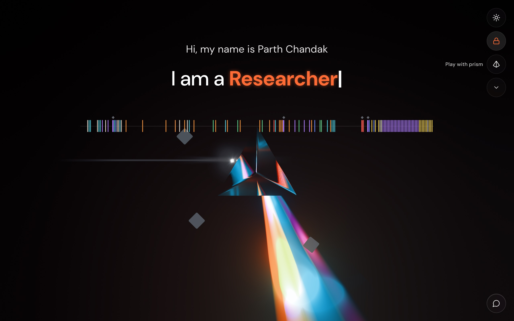
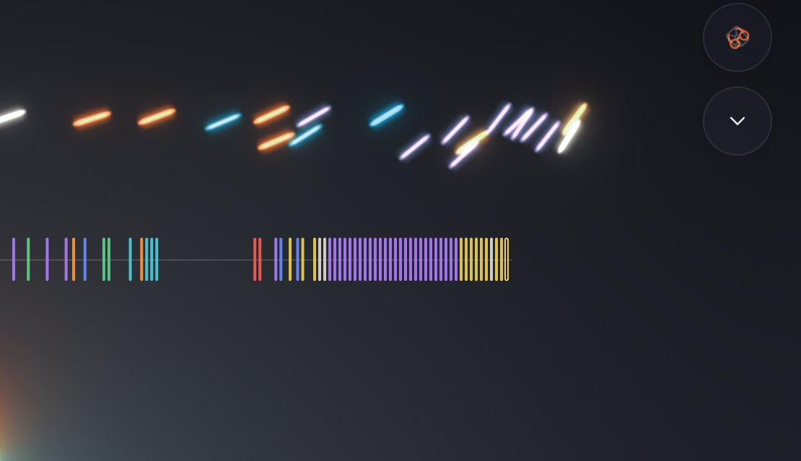
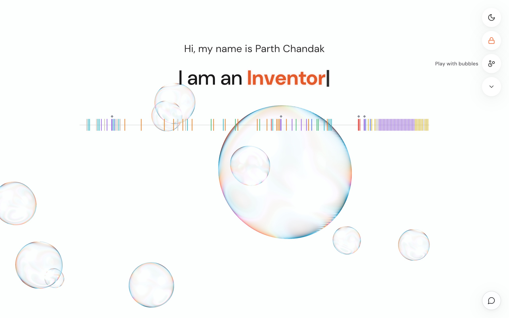
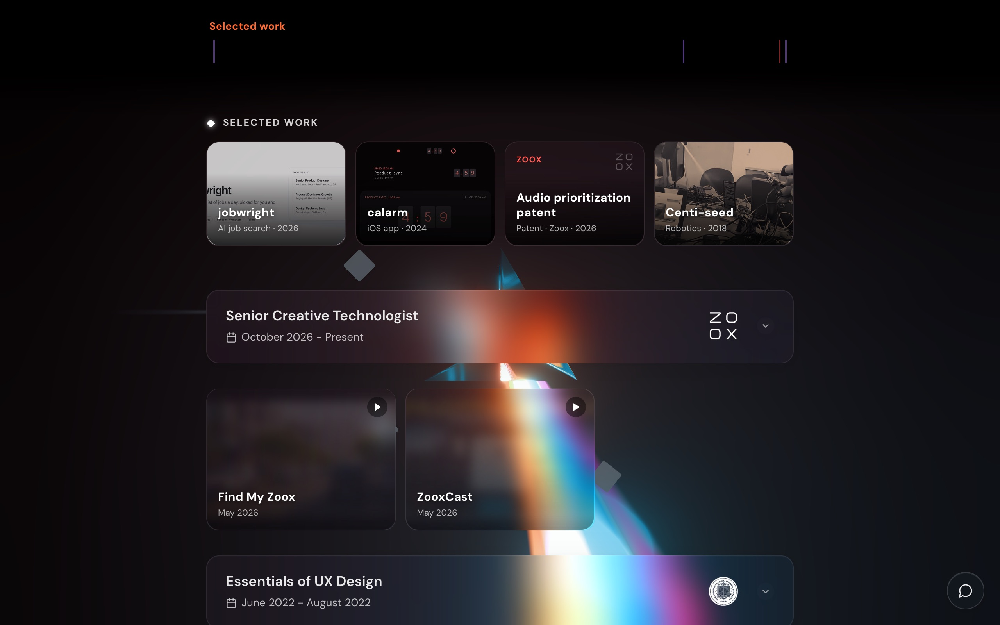
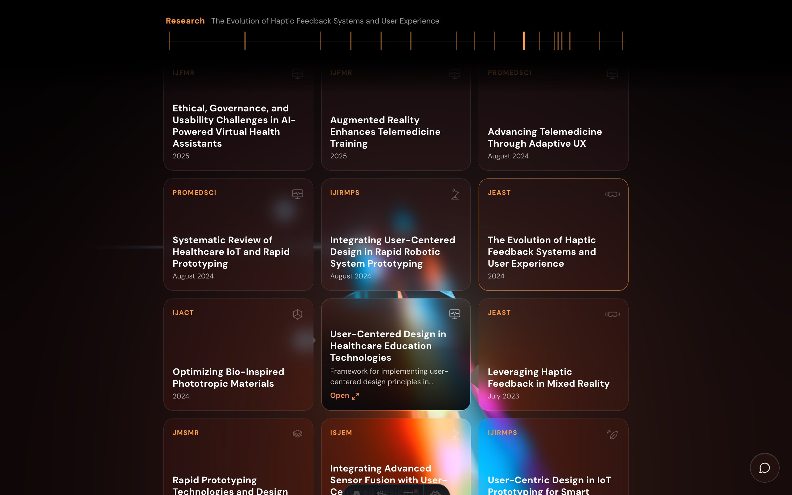
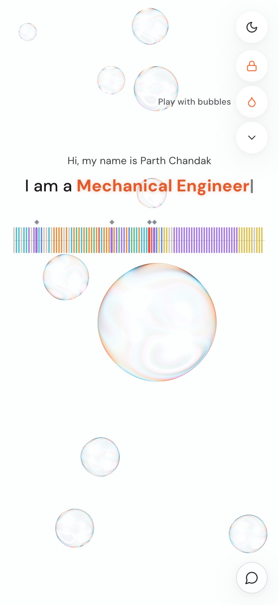

<div align="center">

<h1>parthchandak.info</h1>

<p><b>A portfolio you shine a light through.</b></p>

<p><i>Parth Chandak's personal site: a 3D glass prism that splits a beam into a rainbow, and a portfolio that splits the same way into eight coloured bands. In light mode, soap bubbles take the prism's place.</i></p>

<h6>


</h6>

<a href="https://parthchandak.info"><b>Live demo</b></a> ·
<a href="#how-it-works"><b>How it works</b></a> ·
<a href="#the-portfolio"><b>The portfolio</b></a> ·
<a href="#run-it"><b>Run it</b></a>

<br><br>

<a href="https://parthchandak.info"></a>

<sub>The top of the portfolio on the live site, October 2026.</sub>

</div>

<br>

A first visit opens the **playground**: the prism alone on a black page. A beam of light follows
the pointer (on a phone, any drag steers it), hits a 3D glass prism and leaves as a rainbow. The only
control is **Back to the portfolio**. Returning visitors and `#section` links open **the portfolio**:
a typewriter cycling through roles, a strip of coloured ticks (one per dated item), then **Selected
work** and the full career, research, patent, judging and project history as glass cards, with the
beam held still behind them. In light mode the toy is **soap bubbles** instead of the prism: they drift
from the pointer and burst when tapped.

## How it works

<table>
<tr>
<td width="33%" valign="top">

**1 · The prism**

A GLTF prism in a React Three Fiber scene. The beam's angle follows the pointer; where it
meets the prism, it fans out into a rainbow drawn by a spectral shader. The colours are laid out partly by
the refractive index of BK7 glass (Cauchy's equation), so blue and violet open wider, and the fan widens as
the beam strikes more steeply. Bloom, a colour LUT and dithering come from `@react-three/postprocessing`.

</td>
<td width="33%" valign="top">

**2 · The spectrograph**

Every dated item is one tick on a timeline from 2015 to 2027. The years are warped so the busy
recent ones get room. The chevron unfolds the strip into eight lanes, one per band; folding them back
sends the strip's colours flying into the chevron as light.

</td>
<td width="33%" valign="top">

**3 · The portfolio**

It opens with Selected work: jobwright, calarm, the audio prioritization patent and Centi-seed, each
marked on the strip by a small diamond. Scrolling hands the strip over to a sticky band bar that tracks
which band and card you are on. Cards with a picture or video show as glass tiles, the rest as wide
cards, newest first.

</td>
</tr>
</table>

<div align="center">



<sub>The fold: each colour lifts off the strip as light in the 3D scene and springs into the chevron.</sub>

</div>

**The light and the page move together.** The swarm is drawn inside the 3D scene, not on top of the
page: the strip measures each pill in screen pixels and flies it on [Motion](https://motion.dev)
springs, and the scene places it with the canvas's own box and the camera's zoom, so it lands exactly on
the button on any screen. When it lands, the prism catches the light and a pulse runs out along the
rainbow. Picking an item, or scrolling into a band of the portfolio, lights that band's colour in the rainbow.

### Light mode: soap bubbles

<div align="center">



<sub>Light mode: the bubbles float behind the page.</sub>

</div>

A white page can't show added light, so a beam that glows on black only smears on white. In light mode
the light-splitting object is the soap bubble instead: nearly clear, seen by the room reflected in its
skin and coloured by thin-film interference, worked out in a small shader from the film's thickness
(thinner at the top, as it drains) and the viewing angle. The band you are reading tints the film. In
the playground the bubbles drift from the pointer, and a tap bursts one: the film tears open where it
was touched, the hole races round it, and the retreating rim sheds droplets that fly on, fall and fade.

## The portfolio

<div align="center">



<sub>Selected work, reached with <code>parthchandak.info/#selected</code>.</sub>

</div>

<div align="center">



<sub>The Research band, reached with <code>parthchandak.info/#research</code>.</sub>

</div>

The eight bands, each with its own colour on the strip and the bar:

| Band | Holds |
|---|---|
| Career | Jobs and education |
| Patent | The audio prioritization filing and its publications |
| Research | Papers as text tiles with a journal name and topic mark |
| Judging | Hackathon judging and journal peer review |
| Impact | Volunteering and fundraising |
| Recognition | Awards, talks and press |
| Memberships | Professional societies |
| Projects | Built work, plus the Lab: 27 public side projects shown as one card of tiles |

<div align="center">



<sub>Light mode on a phone-sized screen.</sub>

</div>

## Features

- **Two modes, one page.** The playground is the 3D toy; the portfolio is the readable résumé. First-time visitors get the playground (its button reads "Play with prism", or "Play with bubbles" in light mode); returning visitors and deep links get the portfolio. In the playground every drag steers, and only its button leads back.
- **Deep links per band.** `#selected`, `#experience`, `#research`, `#projects` and the rest open the portfolio scrolled to that section.
- **Light and dark.** Dark mode shows the prism; light mode floats soap bubbles that burst when tapped and take the colour of the band you are reading.
- **Hold still.** The lock holds the beam, or the bubbles in light mode, still while you read.
- **One contact button.** A glass button in the corner whose own glass springs open into the contact card (email, LinkedIn, GitHub, résumé, booking), and springs back.
- **Respects reduced motion.** With reduced motion set, the opening, the swarm and the glow are skipped.
- **Source links.** Ticks with a public source (a DOI, a patent page, a live project, a post) link straight to it, named for what they open: View patent, Read paper, Read post.
- **One data file per thing.** Cards live in `src/data/timelineData.js`, the Lab in `src/data/lab.js`, bands in `src/data/spectrum.js`.
- **Readable before it loads.** Astro writes the whole portfolio into the HTML from the same data files, so search engines and link previews see every card; the 3D scene loads after the text.
- **Static and locked down.** No backend. Cloudflare Pages serves it with HSTS, a strict Content Security Policy and a sitemap.

## Run it

Requires Node 22.12 or newer (`.node-version` pins the one Cloudflare uses).

```bash
git clone https://github.com/parthchandak02/portfolio.git
cd portfolio
npm ci
npm run dev      # http://localhost:3000 (frees port 3000 first)
npm run build    # static site in build/
npm run deploy   # build, then upload build/ to Cloudflare Pages with wrangler
```

Every push to `main` also deploys to Cloudflare Pages (build command `npm run build`, output `build`).
`npm run deploy` needs `CLOUDFLARE_API_TOKEN` and `CLOUDFLARE_ACCOUNT_ID` in the environment.
Add `[skip ci]` to a commit message to skip the build for docs-only changes.

<details>
<summary><b>Project layout</b></summary>

```
src/
  pages/index.astro         The page: head tags, and the portfolio as plain HTML until the app loads
  App.jsx                   Playground / portfolio switch, deep links, theme
  components/
    Canvas3D.jsx, Scene.jsx R3F canvas, post-processing, scene setup, the prism's catch and pulse
    Bubbles.jsx             Light mode's soap bubbles: thin-film shader, bursts and droplets
    Beam.jsx, Prism.jsx,
    Rainbow.jsx, Flare.jsx  The light beam, the GLTF prism, the spectral rainbow and flare
    SwarmLight.jsx          The strip's swarm, drawn as light in the scene
    Spectrograph.jsx        The tick strip and its eight lanes
    SelectedMark.jsx        The small diamond that marks selected work
    BandBar.jsx             Sticky band bar in the portfolio
    Timeline.jsx, TimelineCard.jsx, CardTile.jsx, LabShowcase.jsx
                            Cards, glass tiles and the Lab card
    UITypewriter.jsx        The greeting and cycling roles
    ContactButton.jsx       The contact button and the card its glass springs open into
  data/
    timelineData.js         Every card, by category
    spectrum.js             Band names, colours and dated items
    featured.js             The selected work, in order
    lab.js                  Public side projects
  hooks/                    Mouse, light mode, scroll tracking; prismGlow.js and swarmLight.js
                            connect the page to the scene
public/
  gltf/                     prism.glb
  logos/, images/           Card logos and pictures
  _headers, robots.txt, sitemap.xml, CNAME
scripts/logos/              Tools that render card logos and topic marks to one style
```

</details>

<details>
<summary><b>Editing content</b></summary>

**Add a card.** Append to the right category in `src/data/timelineData.js`:

```javascript
{
  title: "Job title",
  company: "Company",
  companyLogo: "/logos/company-logo.png",
  date: "January 2020 - Present",
  location: "City, State",
  description: "What you did.",
  skills: ["React", "Design"]
}
```

Dates drive placement on the strip: `"February 2022 - Present"` starts at Feb 2022 and is open-ended;
a bare `"2019"` sits mid-year.

**Add a Lab project.** One object in `src/data/lab.js` adds a tile to the Lab and a tick to the
Projects band.

**Add a logo.** Logos are one-colour white marks on a transparent 512 x 512 PNG. Make one from an
organisation's file with `node scripts/logos/make-logo.mjs <source> public/logos/<name>-logo.png`;
see [scripts/logos/README.md](scripts/logos/README.md) for the options and the topic marks.

**Other things to change for your own copy:** `site` in `astro.config.mjs`, the head tags in
`src/pages/index.astro`, `public/CNAME`, the links in `src/components/ContactButton.jsx`, colours in `src/styles.css` and the component CSS files, and
the model at `public/gltf/prism.glb`.

</details>

<details>
<summary><b>Scripts</b></summary>

| Command | Does |
|---|---|
| `npm run dev` | Dev server on port 3000, after freeing the port |
| `npm run build` | Production build into `build/` |
| `npm run preview` | Serve the production build on port 3000 |
| `npm run deploy` | Build and upload to Cloudflare Pages with wrangler |
| `npm run lint` / `lint:fix` | ESLint over `src/` |
| `npm run format` / `format:check` | Prettier over `src/` |
| `npm run health` | `npm outdated` and `npm audit` |
| `npm run clean` | Remove `build/` |

Check a production build locally with `npm run preview`.

</details>

<details>
<summary><b>Deployment and troubleshooting</b></summary>

**Cloudflare Pages setup:** Workers & Pages → Create → Pages → Connect to Git, production branch
`main`, build command `npm run build`, output directory `build`. Add the custom domain under the
project's Custom domains; DNS and TLS are set up automatically. Roll back from Deployments → ⋮ →
Rollback. `public/_headers` sets the security headers, including the CSP; anything that loads from a
new origin (a font, an embed, an image host) has to be added there.

The build is a plain static folder, so Vercel or Netlify work too (build `npm run build`, publish `build`).

| Symptom | Fix |
|---|---|
| Build runs out of memory | `NODE_OPTIONS=--max-old-space-size=4096 npm run build` |
| 3D scene is blank | Check the console for WebGL errors and that `public/gltf/prism.glb` exists |
| Cloudflare build fails on the Node version | `.node-version` must name Node 22.12 or newer |
| Cloudflare build fails | Keep only `package-lock.json` as a lockfile; build command `npm run build` |

</details>

<br>

<div align="center">
<sub>Built with Astro, React, Three.js, React Three Fiber, Motion and Lucide icons. Hosted on Cloudflare Pages.</sub>
</div>
